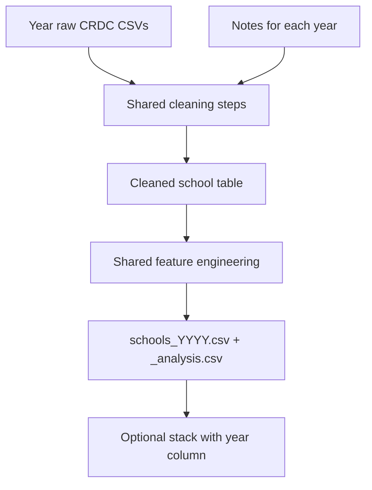

# CRDC data cleaning guide for our team

We’ll each work on one year of the CRDC data. The goal is to clean our files in a consistent way so we can compare them later. **When a feature means the same thing across years, use the same column name and cleaning steps.** If your year has a difference, check the notes for that year below.

Helpful files: [data_audit.md](data_audit.md) (quality findings), [data_dictionary.md](data_dictionary.md) (field meanings), [data/README.md](../data/README.md) (download). File inventory: [data_inventory.md](data_inventory.md).

**Starting point:** we’re using 2021–22 as the example for our shared column names. This guide builds on our earlier data audit. We still need to check the downloaded files and each year’s manual as we clean. Columns with the same name may have different definitions, so please check their meaning too.

**What we’re cleaning:** school characteristics, enrollment, seclusion incidents, staffing, and district characteristics. The file inventory lists more datasets, but we don’t need to clean all of them for this step. Keep any optional data in separate tables, and check with the team before changing the shared columns.

---

## Who works on each year

| Person | Year | Package (as downloaded) | Role |
|---|---|---|---|
| James (Person A) | 2021–22 | `2021-22-crdc-data` | Main year for modeling; share the first example |
| Madison (Person B) | 2017–18 | `2017-18-crdc-data-corrected-publication 2` | Comparison year |
| Juan (Person C) | 2020–21 | `2020-21-crdc-data` | Check how the COVID year compares |
| Sofia (Person D) | 2015–16 | `2015-16-crdc-data` | Fix IDs first; most school data is in one large file |



---

## 1. Shared cleaning steps

Follow these steps for the features in your year. Use the year-specific notes below where they give a different instruction.

| Step | What to do |
|---|---|
| 1. Read | Keep a copy of the original downloads. Read raw fields as strings and strip whitespace. Try `utf-8-sig`, then `cp1252` on decoding failure; use `latin-1` only after inspecting names and recording the reason. Remove rows only if they are completely empty. Keep schools that have some missing values. Record source paths, package version, encoding, and parsed row counts. |
| 2. IDs | Check for blank IDs, non-digit characters, or IDs that are too long before padding `LEAID` to 7 and `SCHID` to 5. Pad valid `COMBOKEY` to 12. Never convert IDs through floats or pad the literal text `nan`. Apply the year-specific repairs below; otherwise check that concatenated components equal `COMBOKEY`. Fix or discuss invalid and duplicate IDs before handing in the file. Don’t just delete duplicates without checking them. |
| 3. Missingness | For counts and FTEs (full-time equivalent staffing), convert values to numbers, note anything that won’t convert, and replace negative values with NA. Keep the original special missing-value codes in the quality-detail file (section 3.3). Treat infinity and other invalid numeric values as missing. Counts must be whole numbers; fractional FTEs are valid. Do not fill unknowns with zero. |
| 4. Categories | Standardize capitalization and spacing to `Yes` / `No` / NA. Translate numeric category codes only using that year’s manual. Record unexpected categories; missing does not mean `No`. |
| 5. School joins | Use School Characteristics as the roster (the wide school file in 2015–16). Left-join Enrollment, Restraint and Seclusion, and School Support on `COMBOKEY`, with `validate="one_to_one"`. Compare key sets before each join; log missing and extra keys. The number of schools in the starting list should stay the same. Check any extra or missing IDs before handing in the files. |
| 6. District join | Left-join LEA Characteristics on `LEAID`, with `validate="many_to_one"`. Report unmatched districts. Use school IDs/names from the starting school list and district details from the LEA file. Select the columns you need before joining so you don’t end up with confusing duplicate columns. Check any ID or name disagreements. |
| 7. Seclusion | After confirming in the year manual that WODIS, IDEA, and 504 incident groups can be added, sum only when all three are valid; otherwise NA. If you’re still unsure about the definitions, leave the total and rate as NA and note what needs checking. Never mix student counts (`TOT_RS_*`) with instances. |
| 8. Enrollment | Make sure both M and F values are valid before calculating an enrollment total. Add valid X only in 2021–22. Missing X does not become a reported zero: preserve it as NA and flag the resulting total as potentially partial. Apply the same rule independently to IDEA, 504, and EL. See section 4. |
| 9. Rows kept | Keep every roster school in the full output. Compute the rate only with a valid seclusion total and positive enrollment. `_analysis.csv` is the subset with valid outcome/denominator; missing predictors may remain. Keep JJ, special-education, virtual, and small schools, and use flags to identify them. |
| 10. FTE review | Flag teachers > 2,000 or any other core FTE > 200 as values to check. These cutoffs don’t automatically mean a value is wrong. Also review the largest 10 values per FTE and the audited 2015–16 value 999. Keep the values unless the source documentation or a recorded team decision supports changing them or setting them to NA. Note each change and why. Check with the team before capping unusually large values. |
| 11. Output | Use the exact columns and order in section 3. Keep other discipline modules and optional extensions out of this core table. Do not impute predictors, scale features, or create a high-seclusion classification during cleaning. |

Reserved negatives observed in the audit include `-9`, `-5`, `-3`, `-6`, `-2`, `-11`, `-12`, and `-13`. Each of us should note what these codes mean in our year’s manual, since the meaning may differ by year. Distinguish reserved codes, blank values, parsing failures, missing modules, and fields not collected. If an expected column is missing, check the file and let the team know before replacing it with an all-NA column.

---

## 2. Which features overlap across years?

### 2.1 Feature comparison across the four years

**Source legend:** C = School Characteristics; E = Enrollment; R = Restraint and Seclusion; S = School Support; L = LEA Characteristics. For 2015–16, C/E/R/S are columns in `CRDC 2015-16 School Data.csv`, and L is `CRDC 2015-16 LEA Data.csv`. For later years, use the corresponding named module CSV. Paths in the year notes are examples; record the actual relative paths.

`same` means the exact raw name or pattern in the 2015–16 column is expected, based on the existing audit/dictionary. Braces expand into separate fields (for example `{M,F}` means `_M` and `_F`); they are not literal headers. Verify every expanded header against the download. `—` means absent from the audited core sources and output NA, with reason `not_collected`.

| Shared output column | Source | 2015–16 raw fields | 2017–18 | 2020–21 | 2021–22 | Shared rule / exception |
|---|---|---|---|---|---|---|
| `combokey`, `leaid`, `schid` | C | `LEAID`, `SCHID`; rebuild `COMBOKEY` | Same; R has bad `SCHID` | Same, stored key valid in audit | Same, stored key valid in audit | Validate and pad IDs; section 1 |
| `lea_state`, `sch_name` | C | `LEA_STATE`, `SCH_NAME` | same | same | same | Trim strings; state uppercase |
| `lea_name` | L | `LEA_NAME` | same | same | same | Use the district file |
| `jj` | C | `JJ` | same | same | `JJ`; compare `SCH_JUST_IND` | Normalize categories; log disagreement |
| `seclusion_instances_{wodis,idea,504}` | R | `SCH_RSINSTANCES_SECL_{WODIS,IDEA,504}` | same | same | same | Nonnegative counts; check that the groups do not overlap before adding them |
| `enrollment_total` | E | `TOT_ENR_{M,F}` | same | same | `TOT_ENR_{M,F,X}` | Strict M+F, optional valid X; flag partial totals |
| `enr_nonbinary` | E | — | — | — | `TOT_ENR_X` | Nonnegative count or NA |
| `enr_idea` | E | `SCH_ENR_IDEA_{M,F}` | same | same | `SCH_ENR_IDEA_{M,F,X}` | Same component rule as enrollment |
| `enr_504` | E | `SCH_ENR_504_{M,F}` | same | same | `SCH_ENR_504_{M,F,X}` | Same component rule; verify 504-only definition |
| `enr_el` | E | `SCH_ENR_LEP_{M,F}` | same | same | `SCH_ENR_EL_{M,F,X}` | Naming change; check that the definitions match |
| `sch_status_{sped,charter,alt,magnet}` | C | `SCH_STATUS_{SPED,CHARTER,ALT,MAGNET}` | same | same | same | Yes/No/NA, never missing→No |
| `sch_virt_ind` | C | — | — | — | `SCH_VIRT_IND` | Do not substitute COVID instruction mode |
| `grade_band` | C | `SCH_GRADE_KG`, `SCH_GRADE_G1` … `SCH_GRADE_G12` | same | same | same | Verify exact headers; grade groups in section 4 |
| `fte_teachers` | S | `SCH_FTETEACH_TOT` | same | same | same | Numeric FTE; preserve fractions; review extremes |
| `fte_counselors` | S | `SCH_FTECOUNSELORS` | same | same | same | Same FTE cleaning |
| `fte_nurses`, `fte_psych`, `fte_social` | S | `SCH_FTESERVICES_{NUR,PSY,SOC}` | same | same | same | Same FTE cleaning; strict three-part support sum |
| `fte_leo`, `fte_guards` | S | `SCH_FTESECURITY_{LEO,GUA}` | same | same | same | Same FTE cleaning; 2017–18 extremes need review |
| `lea_enrollment`, `lea_schools` | L | `LEA_ENR`, `LEA_SCHOOLS` | same | same | same | Nonnegative counts; district join only |

We calculate the rates, percentages, year label, and quality-check flags ourselves using section 4. This table covers the features for our current task, rather than every CRDC column.

**Check the definitions as you go:** in your mapping file, add a row for each source column with the manual filename/page or section, units, students/grades covered, reporting period, and status (`verified` / `unresolved`). Pay extra attention to whether seclusion groups overlap, incidents versus students, which students are counted in rates (including preschool), EL/LEP, 504-only enrollment, and staffing FTEs. Keep the cleaned individual columns while checking anything unclear. Wait until the definitions are clear before using a calculated feature or combining years.

### 2.2 Differences to watch for

| Topic | Years affected | What to do |
|---|---|---|
| File layout | 2015–16 | Pull columns from one wide school CSV + LEA file |
| Stored `COMBOKEY` | 2015–16 | Rebuild: `leaid.zfill(7) + schid.zfill(5)`; ignore stored COMBOKEY for joins; retain it in original files |
| Restraint `SCHID` | 2017–18 | Ignore `SCHID` on Restraint file; join that module on `COMBOKEY` only |
| EL naming | 2021–22 vs earlier | Map `EL` → `enr_el`; earlier map `LEP` → `enr_el` |
| Nonbinary | 2021–22 only | Optional valid denominator add with partial-total flag; earlier years leave `enr_nonbinary` NA |
| Virtual / justice extras | 2021–22 | Also map `SCH_VIRT_IND`, `SCH_JUST_IND` (justice aligns with `jj`) |
| COVID indicators | 2020–21, 2021–22 | Separate optional extension table, not core columns |
| Seclusion completeness | 2020–21 | Expect ~22% missing instances; flag only—never impute 0 |
| Geography | 2015–16 | No PR; later years include PR |
| Expenditures | 2015–16, 2017–18 | Separate optional extension table; absent from shared columns |
| Encoding | 2015–16; 2017–18 Characteristics | Prefer `cp1252` fallback |

---

## 3. What our cleaned files should look like

Everyone should save the **same columns in this order**. Use missing values where a concept does not exist that year and record the reason. When saving CSVs, use: UTF-8, header included, no index, empty cells for NA, `True`/`False` for flags. Read string fields with an explicit string dtype; CSV itself does not preserve dtypes. Read IDs back as strings (`dtype={"combokey": str, "leaid": str, "schid": str}`).

### 3.1 Required columns (all years)

```text
year
combokey
leaid
schid
lea_state
sch_name
lea_name
jj
seclusion_instances_wodis
seclusion_instances_idea
seclusion_instances_504
seclusion_instances
enrollment_total
enr_nonbinary
enr_idea
enr_504
enr_el
seclusion_rate
sch_status_sped
sch_status_charter
sch_status_alt
sch_status_magnet
sch_virt_ind
grade_band
fte_teachers
fte_counselors
fte_nurses
fte_psych
fte_social
fte_leo
fte_guards
counselors_per_100
teachers_per_100
support_fte_per_100
pct_idea
pct_504
pct_el
lea_enrollment
lea_schools
flag_missing_seclusion
flag_missing_enrollment
flag_small_enrollment
flag_fte_outlier
flag_partial_enrollment
flag_partial_idea
flag_partial_504
flag_partial_el
flag_missing_module
flag_missing_lea
flag_analysis_ready
```

### 3.2 Data types and formatting

| Group | Convention |
|---|---|
| IDs | zero-padded strings |
| Counts / FTEs / rates / shares | nullable float |
| Flags `flag_*` | boolean |
| `jj`, school status, `sch_virt_ind` | `Yes` / `No` / NA (string) |
| `grade_band` | `elementary` / `middle` / `high` / `span` / `other` / NA |
| `year` | string label: `2015-16`, `2017-18`, `2020-21`, `2021-22` |

### 3.3 What each person shares with the team

Use `{year}` = `201516`, `201718`, `202021`, or `202122` for filenames and the hyphenated labels in the data. Store generated CSVs in `data/processed/{year}/` (ignored by git). Keep scripts and small reports in git; put generated datasets in the team’s agreed shared data location.

| File | Contents |
|---|---|
| `schools_{year}.csv` | Every roster school, exact section 3.1 columns and order |
| `schools_{year}_analysis.csv` | Exactly the full table filtered to `flag_analysis_ready == True` |
| `quality_detail_{year}.csv` | Long table: `year, source_file, source_row, combokey, leaid, raw_column, raw_value, issue, action, cleaned_value, evidence`. For rows with invalid IDs, record the file and original row number, counting the first data row as 1. Record reserved codes, invalid values, missing fields/modules, category conflicts, outliers, and corrections. District issues use `leaid`; blank `combokey` is allowed. |
| `docs/cleaning/mapping_{year}.csv` | One row per input field: source file/column, shared output column, transformation, units/population/period, manual reference, verification status. Include deliberate absent fields. |
| `docs/cleaning/qa_{year}.md` | Source/package manifest, encodings, rerun command/dependencies, input/output counts, joins/duplicates/invalid IDs, per-field missingness and reserved-code counts, partial totals, outlier decisions, unresolved issues, and five sample keys with lengths |
| `scripts/clean_{year}.py` or equivalent notebook | Include input/output paths that others can change. A notebook should run from top to bottom after restarting the kernel. Add code checks for the cleaning rules and make changes through code so we can repeat them. |

Do not commit raw downloads or large generated CSVs (see [.gitignore](../.gitignore)). In your quality-check report, list the package/manual names and file hashes (checksums) so we can confirm we’re using the same source files. Do not overwrite raw values in the source files.

---

## 4. Features we’ll calculate

These are the calculation rules we’ll use as a team after checking each year’s definitions. If a required part of a sum is missing, the result should be NA. Be careful with sum functions that skip missing values by default.

### Enrollment totals and the numbers used in rates

For each of total, IDEA, 504, and EL enrollment: if M or F is invalid, the total is NA. Otherwise add M+F; in 2021–22 add X only when valid. Set the corresponding `flag_partial_*` to True whenever X is unavailable in 2021–22, even if M/F also prevent a total. Earlier years use False because X is outside their recorded schema; we still need to check whether the years cover the same student groups. `enr_nonbinary` always retains valid X or NA.

If X is unavailable, the total only includes the reported M and F values and may be incomplete. Rates and percentages using that total may also be affected. Count these cases in your quality-check report. Check numerator and denominator population/grade coverage against the manual before accepting rates; do not add preschool enrollment automatically. A subgroup total above total enrollment is a review issue: preserve components, set that derived percentage to NA until resolved, and log it. Don’t change percentages above 100 to 100 just to make them fit. Also, don’t add IDEA/504/EL percentages together as if they are separate groups covering all students.

| Feature | How to calculate it |
|---|---|
| `year` | Use the same hyphenated year label for every row from section 3.2 |
| `seclusion_instances` | Add all three checked incident groups; NA if any are missing |
| `seclusion_rate` | `100 * seclusion_instances / enrollment_total` when numerator valid and denominator > 0; else NA. Units: incidents per 100 students; values > 100 are possible. |
| `pct_idea`, `pct_504`, `pct_el` | `100 * subgroup_enrollment / enrollment_total`, only with valid subgroup count, positive denominator, and subgroup ≤ total; else NA |
| `counselors_per_100`, `teachers_per_100` | `100 * corresponding_FTE / enrollment_total`, with valid FTE and positive denominator; else NA |
| `support_fte_per_100` | `100 * (fte_nurses + fte_psych + fte_social) / enrollment_total`, only if all three FTEs valid and denominator > 0; excludes counselors to avoid changing the stated definition |
| `flag_missing_seclusion` | Derived seclusion total is NA, including unresolved definition |
| `flag_missing_enrollment` | Enrollment total is NA or ≤ 0 |
| `flag_small_enrollment` | Enrollment total is nonmissing and < 10; False when missing. We’re using 10 as a reminder to check small schools; it doesn’t mean their data is wrong. |
| `flag_fte_outlier` | Any core FTE meets section 1 review triggers or is identified as suspicious during review; retain True even after a documented correction |
| `flag_partial_enrollment`, `flag_partial_idea`, `flag_partial_504`, `flag_partial_el` | The corresponding 2021–22 X component is unavailable; False in earlier years |
| `flag_missing_module` | Any required school module has no matching roster row; False for a valid 2015–16 wide-file row. Missing expected columns still need to be checked separately. |
| `flag_missing_lea` | No matching LEA row |
| `flag_analysis_ready` | Valid seclusion total and positive enrollment, with outcome/denominator definitions verified. Other features may still be missing, so more checks may be needed before modeling. |

### Grade-band rule (apply in this order)

Use verified KG/G1–G12 Yes/No fields. Set E = any KG–G5 Yes, M = any G6–G8 Yes, H = any G9–G12 Yes. If any required grade flag is unknown, output NA and report it (the rule we’re using for this project). Otherwise:

1. Two or three of E/M/H are True → `span` (including elementary+middle).
2. Only E → `elementary`; only M → `middle`; only H → `high`.
3. None → `other`, including preschool-only or ungraded-only schools. Do not infer an age band from ungraded status.

**We’ll handle modeling later:** keep `seclusion_rate` as a number and leave `elevated_seclusion` out of these files. We’ll decide any high-seclusion cutoff, which schools to include, and how to split the data during modeling. Keep the outcome and the columns used to calculate it out of the model inputs. For now, leave filling missing values, scaling, capping, and removing rows based on outcomes for that later step.

**Combining years:** matching columns makes it easier to stack the files, but we still need to check definitions, geography (including Puerto Rico), reporting periods, and enrollment totals before comparing years. Use `(year, combokey)` to identify each row. After the quality checks, start modeling with 2021–22 and use the other years to explore how the results compare.

---

## 5. Notes for each year

### James (Person A): 2021–22 (our starting example)

**Modules (typical paths under package root):**

- `SCH/School Characteristics.csv`
- `SCH/Enrollment.csv`
- `SCH/Restraint and Seclusion.csv`
- `SCH/School Support.csv`
- `LEA/LEA Characteristics.csv`
- Optional: `SCH/COVID Directional Indicators.csv`

**Things to watch for**

- English learners: use `SCH_ENR_EL_M` / `SCH_ENR_EL_F` (+ `_X` if valid) → `enr_el`.
- Nonbinary: `TOT_ENR_X` → `enr_nonbinary` when ≥ 0; add into `enrollment_total` only then. Mostly `-9`/`-12`—do not require `_X` for every school.
- Map `SCH_VIRT_IND` → `sch_virt_ind`. Compare `SCH_JUST_IND` with `JJ`; log disagreements and keep `JJ` as the main source pending resolution. Virtual status is a separate concept.
- Encoding: UTF-8 is fine for this package.
- Share the first checked example file and column mapping. Report X availability separately for total, IDEA, 504, and EL enrollment; do not freeze a classification threshold.

**Expected scale (from audit):** 98,010 roster schools; 4,905 with reserved instance values in the prior audit. Recompute final eligible counts after denominator and definition checks; use these counts as a comparison, rather than trying to make your results match them.

---

### Madison (Person B): 2017–18

**Modules:** under `2017-18 Public-Use Files/Data/SCH/CRDC/CSV/` and `.../LEA/CRDC/CSV/`.

**Things to watch for**

- **Restraint `SCHID` is wrong** on almost all rows. Drop/ignore `SCHID` from Restraint and Seclusion; take `schid` from Characteristics (or Enrollment). Join Restraint **only** on `COMBOKEY`.
- English learners: `SCH_ENR_LEP_M` / `SCH_ENR_LEP_F` → `enr_el`.
- `enr_nonbinary` = NA; `sch_virt_ind` = NA.
- Encoding: School Characteristics often needs `cp1252`.
- Optional: `School Expenditures.csv` (separate optional extension; not a main task).
- Watch FTE outliers (e.g. guards/psych extremes)—shared review process applies.

**Expected scale:** ~97,632 schools; ~91k with usable instance triple.

---

### Juan (Person C): 2020–21

**Modules:** under `CRDC/School/` and `CRDC/LEA/`.

**Things to watch for**

- Heavy reserved codes on seclusion (`-11`, `-13`, …). Expect roughly **one in five** schools with missing instance totals. Set `flag_missing_seclusion`; **never** impute 0.
- English learners: `LEP` → `enr_el`.
- `enr_nonbinary` = NA; `sch_virt_ind` = NA in the audited source. Investigate a different header inventory rather than substituting COVID virtual-mode fields.
- Optional COVID file: `COVID Directional Indicators.csv` for context only (separate extension table; not part of the shared columns).
- We’ll use this year to **check how the COVID period compares**. Our main modeling year is still 2021–22.

**Expected scale:** ~97,575 schools; ~76.5k with usable instance triple.

---

### Sofia (Person D): 2015–16

**Files:**

- `Data Files and Layouts/CRDC 2015-16 School Data.csv` (wide, ~1,836 cols)
- `Data Files and Layouts/CRDC 2015-16 LEA Data.csv`

**Things to watch for**

- No split module CSVs: select the same raw field names from the wide school file (Restraint/Enrollment/Characteristics/Support columns are already present as columns).
- **Rebuild `combokey`** = `leaid.zfill(7) + schid.zfill(5)`. Ignore the stored `COMBOKEY` for joins (Excel/scientific-notation corruption); retain it in original files.
- English learners: `LEP` → `enr_el`.
- `enr_nonbinary` = NA; `sch_virt_ind` = NA.
- Encoding: use `cp1252` / `latin-1` fallback.
- Inspect the audited 999 values in staffing fields; do not assume their meaning without documentation.
- Geography: no Puerto Rico.
- Optional expenditures columns exist in the wide file; main task still matches section 3 (leave extra $ fields out unless coordinator asks).

**Expected scale:** 96,360 unique schools after ID repair; zero duplicate `combokey` after rebuild.

---

## 6. Quick checks before sharing your work

Add code checks where you can and summarize the results in your quality-check report:

- [ ] List the source files, manual references, column mapping, and command to rerun your work. Check the definitions for all calculated features you plan to share as ready to use.
- [ ] Keys are nonblank digit strings of lengths 12/7/5; component IDs agree with the canonical key after documented repairs. No duplicate school keys or district keys.
- [ ] Each join preserves roster row count and uniqueness. Missing/extra keys and identity disagreements are reported and unexplained discrepancies resolved.
- [ ] No negatives/non-finite values remain in count/FTE fields; count fractions and numeric parse failures are reported and resolved. Reported zeros remain zeros.
- [ ] Sums and rates become NA when required values are missing, and partial-X flags are correct. Include sample checks for missing M/F, missing X, zero enrollment, and missing support FTE.
- [ ] Each school has only one `grade_band` and follows section 4, including KG–8 → span, KG–12 → span, high-only → high, and unknown grade flag → NA.
- [ ] Every flagged FTE is counted; retained/corrected/set-to-NA decisions are documented. Explain any capping or filling of missing values; these should follow a team decision.
- [ ] Full output equals the roster in row count; schema/order exactly match section 3.1. Reload the CSV with explicit dtypes and verify leading zeros, missing values, flags, and row counts.
- [ ] Analysis output exactly equals the full table filtered by `flag_analysis_ready`. Missing predictors and partial denominators are summarized; this file can still have missing model inputs.
- [ ] Rates are finite or NA, never infinite. Seclusion rates > 100 are not automatically invalid; subgroup percentages > 100 are investigated.
- [ ] Quality detail retains original reserved codes and correction evidence. QA includes five sample IDs, per-column missingness, and counts by JJ, small enrollment, and partial-denominator flags.
- [ ] Fresh rerun reproduces outputs. Same-year discipline predictors, classification cutoffs, and optional extensions are absent from the shared columns.

**Final team check:** compare the four column mappings, reload the files with the same data types, check that the columns match, and make sure `(year, combokey)` is unique when files are stacked. Spot-check the repaired 2015–16 IDs and the 2017–18 restraint join. Explain any differences from the earlier audit counts. If a file still has unclear definitions or invalid IDs, work through those before using it; everyone else can keep going on their year.

## 7. How we’ll work through this

1. Follow the year assignments above and agree on where we’ll save the cleaned files. Make sure everyone has this guide, the audit, the dictionary, and their data files/manuals.
2. Check the columns and definitions for your year. Share missing columns or differences with the team before making a different mapping.
3. James shares the first example with our shared columns. Everyone can work on their own year at the same time using the notes in section 5.
4. Share your code, column mapping, quality-check report, quality-detail file, and both school tables. Record team decisions in this guide so everyone follows the same updates.
5. Go through section 6 together. Once the cleaned files are ready, we can decide how to handle missing model inputs, unusual staffing values, incomplete enrollment totals, small/JJ schools, and any high-seclusion cutoff.
