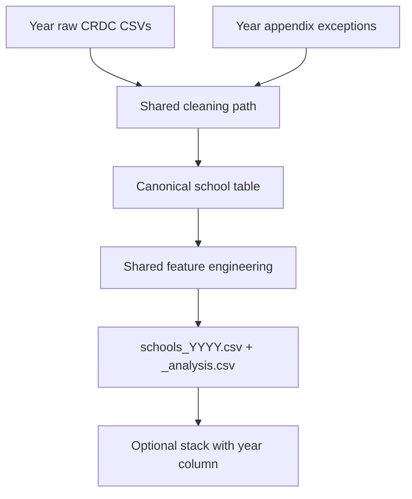

# CRDC cleaning & feature-engineering playbook

Rules for four year-owners. **If a feature is the same (or maps cleanly), follow the shared path and emit the same canonical column name.** If a year differs, use only that year’s appendix—do not invent a parallel name for the same concept.

Companions: [data_audit.md](data_audit.md) (quality findings), [data_dictionary.md](data_dictionary.md) (field meanings), [data/README.md](../data/README.md) (download). File inventory: [task2/docs/data_inventory.md](../task2/docs/data_inventory.md).

**Reference schema:** 2021–22. Other years map into the same output contract. This is the team’s cleaning handoff (v1), based on the repository audit, not a new verification of the downloaded CSVs or manuals. A matching header is evidence of structural overlap, not proof of an unchanged definition.

**Start here:** each owner reads §1–4 and their appendix, verifies their source headers and manual definitions, then delivers the files in §3.3 and completes §6. The coordinator assigns names to A–D and reconciles definition differences before accepting outputs. All four owners can begin in parallel; A provides the first example output.

**Scope:** clean the core school characteristics, enrollment, seclusion instances, staffing, and district characteristics. The full file inventory covers other modules, but those are not all cleaning assignments. Keep optional modules in separate extension tables; do not add columns to the core schema independently.

---

## Assignments

| Person | Year | Package (as downloaded) | Role |
|---|---|---|---|
| A | 2021–22 | `2021-22-crdc-data` | Main modeling cohort; finish first |
| B | 2017–18 | `2017-18-crdc-data-corrected-publication 2` | Comparison year |
| C | 2020–21 | `2020-21-crdc-data` | COVID / robustness only |
| D | 2015–16 | `2015-16-crdc-data` | Usable after ID repair (wide file) |



---

## 1. Shared cleaning path

Apply these steps whenever the feature exists in your year. Year appendices override only what they list.

| Step | Rule |
|---|---|
| 1. Read | Preserve original downloads. Read raw fields as strings and strip whitespace. Try `utf-8-sig`, then `cp1252` on decoding failure; use `latin-1` only after inspecting names and recording the reason. Remove wholly empty rows, never partially missing schools. Record source paths, package version, encoding, and parsed row counts. |
| 2. IDs | Reject blank, non-digit, or overlength component IDs before padding `LEAID` to 7 and `SCHID` to 5. Pad valid `COMBOKEY` to 12. Never convert IDs through floats or pad the literal text `nan`. Apply the year-specific repairs below; otherwise check that concatenated components equal `COMBOKEY`. Stop acceptance on unresolved invalid or duplicate keys; do not silently deduplicate. |
| 3. Missingness | For count/FTE fields only, parse numeric values, record parse failures, and replace negatives with NA. Preserve each original reserved code in the quality detail (§3.3). Reject non-finite values. Counts must be whole numbers; fractional FTEs are valid. Do not fill unknowns with zero. |
| 4. Categories | Normalize case/whitespace to `Yes` / `No` / NA. Translate numeric category codes only using that year’s manual. Record unexpected categories; missing does not mean `No`. |
| 5. School joins | Use School Characteristics as the roster (the wide school file in 2015–16). Left-join Enrollment, Restraint and Seclusion, and School Support on `COMBOKEY`, with `validate="one_to_one"`. Compare key sets before each join; log missing and extra keys. Roster rows must not multiply or disappear. Resolve unexplained extra module keys before accepting delivery. |
| 6. District join | Left-join LEA Characteristics on `LEAID`, with `validate="many_to_one"`. Report unmatched districts. Use roster identity/name fields and LEA-file district attributes; select only required columns before joining to avoid ambiguous suffixes. Check conflicting repeated identity fields. |
| 7. Seclusion | After confirming in the year manual that WODIS, IDEA, and 504 instance buckets can be added, sum only when all three are valid; otherwise NA. Until definitions are verified, leave the derived total/rate NA and record the unresolved issue. Never mix student counts (`TOT_RS_*`) with instances. |
| 8. Enrollment | Require valid M and F components for every enrollment total. Add valid X only in 2021–22. Missing X does not become a reported zero: preserve it as NA and flag the resulting total as potentially partial. Apply the same rule independently to IDEA, 504, and EL. See §4. |
| 9. Rows kept | Keep every roster school in the full output. Compute the rate only with a valid seclusion total and positive enrollment. `_analysis.csv` is the subset with valid outcome/denominator; missing predictors may remain. Retain JJ, special-education, virtual, and small schools with flags. |
| 10. FTE review | Flag teachers > 2,000 or any other core FTE > 200 as provisional review triggers, not automatic deletion/capping thresholds. Also review the largest 10 values per FTE and the audited 2015–16 value 999. Preserve values unless source evidence or a documented coordinator decision justifies correction/NA. Log every change and reason; no independent winsorization. |
| 11. Output | Emit the exact §3 schema. Keep other discipline modules and optional extensions out of this core table. Do not impute predictors, scale features, or create a high-seclusion classification during cleaning. |

Reserved negatives observed in the audit include `-9`, `-5`, `-3`, `-6`, `-2`, `-11`, `-12`, and `-13`. Owners must record their year manual’s meanings; do not guess what a code means from another year. Distinguish reserved codes, blank values, parsing failures, missing modules, and fields not collected. Missing expected headers are an error to investigate, not permission to silently create an all-NA column.

---

## 2. Canonical feature map

### 2.1 Four-year overlap matrix

**Source legend:** C = School Characteristics; E = Enrollment; R = Restraint and Seclusion; S = School Support; L = LEA Characteristics. For 2015–16, C/E/R/S are columns in `CRDC 2015-16 School Data.csv`, and L is `CRDC 2015-16 LEA Data.csv`. For later years, use the corresponding named module CSV. Paths in appendices are examples; record the actual relative paths.

`same` means the exact raw name or pattern in the 2015–16 column is expected, based on the existing audit/dictionary. Braces expand into separate fields (for example `{M,F}` means `_M` and `_F`); they are not literal headers. Verify every expanded header against the download. `—` means absent from the audited core sources and output NA, with reason `not_collected`.

| Output concept / canonical column | Source | 2015–16 raw fields | 2017–18 | 2020–21 | 2021–22 | Shared rule / exception |
|---|---|---|---|---|---|---|
| `combokey`, `leaid`, `schid` | C | `LEAID`, `SCHID`; rebuild `COMBOKEY` | Same; R has bad `SCHID` | Same, stored key valid in audit | Same, stored key valid in audit | Validate and pad IDs; §1 |
| `lea_state`, `sch_name` | C | `LEA_STATE`, `SCH_NAME` | same | same | same | Trim strings; state uppercase |
| `lea_name` | L | `LEA_NAME` | same | same | same | District source is authoritative |
| `jj` | C | `JJ` | same | same | `JJ`; compare `SCH_JUST_IND` | Normalize categories; log disagreement |
| `seclusion_instances_{wodis,idea,504}` | R | `SCH_RSINSTANCES_SECL_{WODIS,IDEA,504}` | same | same | same | Nonnegative counts; verify disjoint bucket definitions before summing |
| `enrollment_total` | E | `TOT_ENR_{M,F}` | same | same | `TOT_ENR_{M,F,X}` | Strict M+F, optional valid X; flag partial totals |
| `enr_nonbinary` | E | — | — | — | `TOT_ENR_X` | Nonnegative count or NA |
| `enr_idea` | E | `SCH_ENR_IDEA_{M,F}` | same | same | `SCH_ENR_IDEA_{M,F,X}` | Same component rule as enrollment |
| `enr_504` | E | `SCH_ENR_504_{M,F}` | same | same | `SCH_ENR_504_{M,F,X}` | Same component rule; verify 504-only definition |
| `enr_el` | E | `SCH_ENR_LEP_{M,F}` | same | same | `SCH_ENR_EL_{M,F,X}` | Naming change; verify definitions before declaring equivalence |
| `sch_status_{sped,charter,alt,magnet}` | C | `SCH_STATUS_{SPED,CHARTER,ALT,MAGNET}` | same | same | same | Yes/No/NA, never missing→No |
| `sch_virt_ind` | C | — | — | — | `SCH_VIRT_IND` | Do not substitute COVID instruction mode |
| `grade_band` | C | `SCH_GRADE_KG`, `SCH_GRADE_G1` … `SCH_GRADE_G12` | same | same | same | Verify exact headers; mutually exclusive bands in §4 |
| `fte_teachers` | S | `SCH_FTETEACH_TOT` | same | same | same | Numeric FTE; preserve fractions; review extremes |
| `fte_counselors` | S | `SCH_FTECOUNSELORS` | same | same | same | Same FTE cleaning |
| `fte_nurses`, `fte_psych`, `fte_social` | S | `SCH_FTESERVICES_{NUR,PSY,SOC}` | same | same | same | Same FTE cleaning; strict three-part support sum |
| `fte_leo`, `fte_guards` | S | `SCH_FTESECURITY_{LEO,GUA}` | same | same | same | Same FTE cleaning; 2017–18 extremes need review |
| `lea_enrollment`, `lea_schools` | L | `LEA_ENR`, `LEA_SCHOOLS` | same | same | same | Nonnegative counts; district join only |

The derived rates, percentages, year label, and QA flags have no direct raw counterpart; their exact rules are in §4. The matrix covers the core assignment, not every field in the CRDC collection.

**Definition verification:** each owner supplies one mapping row per source field, with its manual filename/page or section, units, population/grade coverage, reporting period, and status (`verified` / `unresolved`). Prioritize seclusion bucket disjointness, incident versus student counts, numerator/denominator coverage (including preschool), EL/LEP, 504-only enrollment, and school staffing FTE definitions. Preserve cleaned components while investigating a definition. Do not accept a derived measure with unresolved source semantics or pool years merely because their output names match.

### 2.2 Different — use year appendix (do not invent a second path)

| Topic | Years affected | What to do |
|---|---|---|
| File layout | 2015–16 | Pull columns from one wide school CSV + LEA file |
| Stored `COMBOKEY` | 2015–16 | Rebuild: `leaid.zfill(7) + schid.zfill(5)`; ignore stored COMBOKEY for joins; retain it in raw evidence |
| Restraint `SCHID` | 2017–18 | Ignore `SCHID` on Restraint file; join that module on `COMBOKEY` only |
| EL naming | 2021–22 vs earlier | Map `EL` → `enr_el`; earlier map `LEP` → `enr_el` |
| Nonbinary | 2021–22 only | Optional valid denominator add with partial-total flag; earlier years leave `enr_nonbinary` NA |
| Virtual / justice extras | 2021–22 | Also map `SCH_VIRT_IND`, `SCH_JUST_IND` (justice aligns with `jj`) |
| COVID indicators | 2020–21, 2021–22 | Separate optional extension table, not core columns |
| Seclusion completeness | 2020–21 | Expect ~22% missing instances; flag only—never impute 0 |
| Geography | 2015–16 | No PR; later years include PR |
| Expenditures | 2015–16, 2017–18 | Separate optional extension table; absent from core schema |
| Encoding | 2015–16; 2017–18 Characteristics | Prefer `cp1252` fallback |

---

## 3. Shared output contract (v1)

Every year emits the **same columns in this order**. Use missing values where a concept does not exist that year and record the reason. CSV serialization: UTF-8, header included, no index, empty cells for NA, `True`/`False` for flags. Read string fields with an explicit string dtype; CSV itself does not preserve dtypes. Read IDs back as strings (`dtype={"combokey": str, "leaid": str, "schid": str}`).

### 3.1 Required columns (all years)

```text
year
combokey
leaid
schid
lea_state
sch_name
lea_name
jj
seclusion_instances_wodis
seclusion_instances_idea
seclusion_instances_504
seclusion_instances
enrollment_total
enr_nonbinary
enr_idea
enr_504
enr_el
seclusion_rate
sch_status_sped
sch_status_charter
sch_status_alt
sch_status_magnet
sch_virt_ind
grade_band
fte_teachers
fte_counselors
fte_nurses
fte_psych
fte_social
fte_leo
fte_guards
counselors_per_100
teachers_per_100
support_fte_per_100
pct_idea
pct_504
pct_el
lea_enrollment
lea_schools
flag_missing_seclusion
flag_missing_enrollment
flag_small_enrollment
flag_fte_outlier
flag_partial_enrollment
flag_partial_idea
flag_partial_504
flag_partial_el
flag_missing_module
flag_missing_lea
flag_analysis_ready
```

### 3.2 Types and conventions

| Group | Convention |
|---|---|
| IDs | zero-padded strings |
| Counts / FTEs / rates / shares | nullable float |
| Flags `flag_*` | boolean |
| `jj`, school status, `sch_virt_ind` | `Yes` / `No` / NA (string) |
| `grade_band` | `elementary` / `middle` / `high` / `span` / `other` / NA |
| `year` | string label: `2015-16`, `2017-18`, `2020-21`, `2021-22` |

### 3.3 Files each person delivers

Use `{year}` = `201516`, `201718`, `202021`, or `202122` for filenames and the hyphenated labels in the data. Store generated CSVs in `data/processed/{year}/` (ignored by git). Keep scripts and small reports in git; put generated datasets in the team’s agreed shared data location.

| File | Contents |
|---|---|
| `schools_{year}.csv` | Every roster school, exact §3.1 columns and order |
| `schools_{year}_analysis.csv` | Exactly the full table filtered to `flag_analysis_ready == True` |
| `quality_detail_{year}.csv` | Long table: `year, source_file, source_row, combokey, leaid, raw_column, raw_value, issue, action, cleaned_value, evidence`. Keep invalid-key rows identifiable by file and original 1-based data-row number. Record reserved codes, invalid values, missing fields/modules, category conflicts, outliers, and corrections. District issues use `leaid`; blank `combokey` is allowed. |
| `docs/cleaning/mapping_{year}.csv` | One row per input field: source file/column, canonical destination, transformation, units/population/period, manual reference, verification status. Include deliberate absent fields. |
| `docs/cleaning/qa_{year}.md` | Source/package manifest, encodings, rerun command/dependencies, input/output counts, joins/duplicates/invalid IDs, per-field missingness and reserved-code counts, partial totals, outlier decisions, unresolved issues, and five sample keys with lengths |
| `scripts/clean_{year}.py` or equivalent notebook | Rerunnable from raw inputs with configurable input/output paths. Notebook must run top-to-bottom in a fresh kernel. Include validation assertions; no manual spreadsheet edits. |

Do not commit raw downloads or large generated CSVs (see [.gitignore](../.gitignore)). Record package/manual names and file hashes in the QA manifest so the result can be reproduced. Do not overwrite raw values in the source files.

---

## 4. Shared feature engineering

These are project conventions, not claims that the source definitions are identical across years. Verify source semantics first. All sums below are strict: a missing required component makes the result NA. Do not use the default skip-NA sum for required components.

### Enrollment and denominator convention

For each of total, IDEA, 504, and EL enrollment: if M or F is invalid, the total is NA. Otherwise add M+F; in 2021–22 add X only when valid. Set the corresponding `flag_partial_*` to True whenever X is unavailable in 2021–22, even if M/F also prevent a total. Earlier years use False because X is outside their recorded schema; this does not establish cross-year population equivalence. `enr_nonbinary` always retains valid X or NA.

A total with unavailable X is a **reported-component total**, potentially incomplete. Rates/shares based on it inherit this limitation. Count these cases in QA. Check numerator and denominator population/grade coverage against the manual before accepting rates; do not add preschool enrollment automatically. A subgroup total above total enrollment is a review issue: preserve components, set that derived percentage to NA until resolved, and log it. Never clamp shares to 100 or sum IDEA/504/EL shares into a population partition.

| Feature | Exact rule |
|---|---|
| `year` | Constant hyphenated year label from §3.2 |
| `seclusion_instances` | Strict sum of the three verified instance buckets |
| `seclusion_rate` | `100 * seclusion_instances / enrollment_total` when numerator valid and denominator > 0; else NA. Units: incidents per 100 students; values > 100 are possible. |
| `pct_idea`, `pct_504`, `pct_el` | `100 * subgroup_enrollment / enrollment_total`, only with valid subgroup count, positive denominator, and subgroup ≤ total; else NA |
| `counselors_per_100`, `teachers_per_100` | `100 * corresponding_FTE / enrollment_total`, with valid FTE and positive denominator; else NA |
| `support_fte_per_100` | `100 * (fte_nurses + fte_psych + fte_social) / enrollment_total`, only if all three FTEs valid and denominator > 0; excludes counselors to avoid changing the stated definition |
| `flag_missing_seclusion` | Derived seclusion total is NA, including unresolved definition |
| `flag_missing_enrollment` | Enrollment total is NA or ≤ 0 |
| `flag_small_enrollment` | Enrollment total is nonmissing and < 10; False when missing. Ten is a project review threshold, not a source validity rule. |
| `flag_fte_outlier` | Any core FTE meets §1 review triggers or is identified as suspicious during review; retain True even after a documented correction |
| `flag_partial_enrollment`, `flag_partial_idea`, `flag_partial_504`, `flag_partial_el` | The corresponding 2021–22 X component is unavailable; False in earlier years |
| `flag_missing_module` | Any required school module has no matching roster row; False for a valid 2015–16 wide-file row. Missing expected columns are separate delivery errors. |
| `flag_missing_lea` | No matching LEA row |
| `flag_analysis_ready` | Valid seclusion total and positive enrollment, with outcome/denominator definitions verified. Does not guarantee complete predictors or suitability for every model. |

### Grade-band rule (apply in this order)

Use verified KG/G1–G12 Yes/No fields. Set E = any KG–G5 Yes, M = any G6–G8 Yes, H = any G9–G12 Yes. If any required grade flag is unknown, output NA and report it (conservative project convention). Otherwise:

1. Two or three of E/M/H are True → `span` (including elementary+middle).
2. Only E → `elementary`; only M → `middle`; only H → `high`.
3. None → `other`, including preschool-only or ungraded-only schools. Do not infer an age band from ungraded status.

**Modeling comes later:** retain the continuous rate; omit `elevated_seclusion` from cleaning outputs. The modeling team must specify any class threshold, population, and evaluation split before fitting it. Keep outcomes and their components out of predictor inputs. No imputation, scaling, arbitrary capping, or outcome-based row removal during this handoff.

**Pooling:** aligned columns permit stacking, not automatic comparability. For cross-year EDA, first reconcile definitions, geography (PR), reporting periods, and denominator limitations; use `(year, combokey)` as the row key. Start modeling with 2021–22 after QA; treat other years as comparisons/sensitivity analyses until reviewed.

---

## 5. Year appendices (exceptions only)

### Appendix A — Person A: 2021–22 (reference)

**Modules (typical paths under package root):**

- `SCH/School Characteristics.csv`
- `SCH/Enrollment.csv`
- `SCH/Restraint and Seclusion.csv`
- `SCH/School Support.csv`
- `LEA/LEA Characteristics.csv`
- Optional: `SCH/COVID Directional Indicators.csv`

**Exceptions / extras**

- English learners: use `SCH_ENR_EL_M` / `SCH_ENR_EL_F` (+ `_X` if valid) → `enr_el`.
- Nonbinary: `TOT_ENR_X` → `enr_nonbinary` when ≥ 0; add into `enrollment_total` only then. Mostly `-9`/`-12`—do not require `_X` for every school.
- Map `SCH_VIRT_IND` → `sch_virt_ind`. Compare `SCH_JUST_IND` with `JJ`; log disagreements and keep `JJ` as the canonical source pending resolution. Virtual status is a separate concept.
- Encoding: UTF-8 is fine for this package.
- Publish the first validated example output and mapping. Report X availability separately for total, IDEA, 504, and EL enrollment; do not freeze a classification threshold.

**Expected scale (from audit):** 98,010 roster schools; 4,905 with reserved instance values in the prior audit. Recompute final eligible counts after denominator and definition checks; these are reference counts, not acceptance targets.

---

### Appendix B — Person B: 2017–18

**Modules:** under `2017-18 Public-Use Files/Data/SCH/CRDC/CSV/` and `.../LEA/CRDC/CSV/`.

**Exceptions**

- **Restraint `SCHID` is wrong** on almost all rows. Drop/ignore `SCHID` from Restraint and Seclusion; take `schid` from Characteristics (or Enrollment). Join Restraint **only** on `COMBOKEY`.
- English learners: `SCH_ENR_LEP_M` / `SCH_ENR_LEP_F` → `enr_el`.
- `enr_nonbinary` = NA; `sch_virt_ind` = NA.
- Encoding: School Characteristics often needs `cp1252`.
- Optional: `School Expenditures.csv` (separate optional extension; not a core deliverable).
- Watch FTE outliers (e.g. guards/psych extremes)—shared review process applies.

**Expected scale:** ~97,632 schools; ~91k with usable instance triple.

---

### Appendix C — Person C: 2020–21

**Modules:** under `CRDC/School/` and `CRDC/LEA/`.

**Exceptions**

- Heavy reserved codes on seclusion (`-11`, `-13`, …). Expect roughly **one in five** schools with missing instance totals. Set `flag_missing_seclusion`; **never** impute 0.
- English learners: `LEP` → `enr_el`.
- `enr_nonbinary` = NA; `sch_virt_ind` = NA in the audited source. Investigate a different header inventory rather than substituting COVID virtual-mode fields.
- Optional COVID file: `COVID Directional Indicators.csv` for context only (separate extension table; not part of the core schema).
- This year is **robustness / COVID sensitivity**, not the primary training cohort.

**Expected scale:** ~97,575 schools; ~76.5k with usable instance triple.

---

### Appendix D — Person D: 2015–16

**Files:**

- `Data Files and Layouts/CRDC 2015-16 School Data.csv` (wide, ~1,836 cols)
- `Data Files and Layouts/CRDC 2015-16 LEA Data.csv`

**Exceptions**

- No split module CSVs: select the same raw field names from the wide school file (Restraint/Enrollment/Characteristics/Support columns are already present as columns).
- **Rebuild `combokey`** = `leaid.zfill(7) + schid.zfill(5)`. Ignore the stored `COMBOKEY` for joins (Excel/scientific-notation corruption); retain it in raw evidence.
- English learners: `LEP` → `enr_el`.
- `enr_nonbinary` = NA; `sch_virt_ind` = NA.
- Encoding: use `cp1252` / `latin-1` fallback.
- Inspect the audited 999 values in staffing fields; do not assume their meaning without documentation.
- Geography: no Puerto Rico.
- Optional expenditures columns exist in the wide file; core deliverable still matches §3 (leave extra $ fields out unless coordinator asks).

**Expected scale:** 96,360 unique schools after ID repair; zero duplicate `combokey` after rebuild.

---

## 6. QA checklist (before handoff)

Each owner includes executable assertions where possible and evidence in their QA report:

- [ ] Source manifest, manual references, field mapping, and exact rerun command are included. All required definitions are resolved for accepted derived measures.
- [ ] Keys are nonblank digit strings of lengths 12/7/5; component IDs agree with the canonical key after documented repairs. No duplicate school keys or district keys.
- [ ] Each join preserves roster row count and uniqueness. Missing/extra keys and identity disagreements are reported and unexplained discrepancies resolved.
- [ ] No negatives/non-finite values remain in count/FTE fields; count fractions and numeric parse failures are reported and resolved. Reported zeros remain zeros.
- [ ] Required-component missingness propagates through sums/rates; partial-X flags are correct. Include sample checks for missing M/F, missing X, zero enrollment, and missing support FTE.
- [ ] `grade_band` is exclusive and follows §4, including KG–8 → span, KG–12 → span, high-only → high, and unknown grade flag → NA.
- [ ] Every flagged FTE is counted; retained/corrected/set-to-NA decisions are documented. No undocumented caps or imputations.
- [ ] Full output equals the roster in row count; schema/order exactly match §3.1. Reload the CSV with explicit dtypes and verify leading zeros, missing values, flags, and row counts.
- [ ] Analysis output exactly equals the full table filtered by `flag_analysis_ready`. Missing predictors and partial denominators are summarized; this is not a model-complete-case filter.
- [ ] Rates are finite or NA, never infinite. Seclusion rates > 100 are not automatically invalid; subgroup percentages > 100 are investigated.
- [ ] Quality detail retains original reserved codes and correction evidence. QA includes five sample IDs, per-column missingness, and counts by JJ, small enrollment, and partial-denominator flags.
- [ ] Fresh rerun reproduces outputs. Same-year discipline predictors, classification cutoffs, and optional extensions are absent from the core schema.

**Coordinator acceptance:** check the four mappings against one another, reload all outputs with the same dtypes, confirm identical schemas, and verify unique `(year, combokey)` on any stack. Spot-check the 2015–16 rebuilt key and 2017–18 restraint join. Compare measured counts with the audit and explain differences rather than forcing the old counts. Unresolved source semantics or invalid keys block acceptance of the affected deliverable; other owners continue independent work.

## 7. Coordination order

1. Coordinator assigns A–D and shares this playbook, audit, dictionary, source packages/manuals, and generated-data destination. This local file still needs to be committed/shared; its existence does not mean it has been published.
2. All owners inventory headers and verify definitions; report missing fields or incompatible meanings before implementing alternative mappings.
3. A provides the first example using the shared schema. B–D clean their assigned years concurrently and follow their appendices.
4. Each owner submits code, mapping, QA, quality detail, and both school tables. Coordinator resolves shared decisions in this playbook and records any schema revision for all four owners.
5. Coordinator completes §6 acceptance. Subsequent modeling decisions include predictor missingness, suspicious staffing values, partial denominators, small-school/JJ sensitivity analyses, and any elevated-seclusion definition.
